# Port of Olivia Jack's Hydra to TouchDesigner

This is a full function-to-component port of Olivia Jack's [`hydra`](https://github.com/hydra-synth) visual synth engine to TouchDesigner.

[`hydra` project API](https://hydra.ojack.xyz/api/) is built using [GLSL functions](https://github.com/hydra-synth/hydra-functions/blob/main/libs/hydra/glsl-functions.js), in this case its WebGL.

TouchDesigner has GLSL TOP which uses native OpenGL.

This project is built 96% with the help of Claude Code in two relaxed days. [Headless Hydra](https://codeberg.org/gugray/HeadlessHydra) source also helped in the work.

## Screenshots

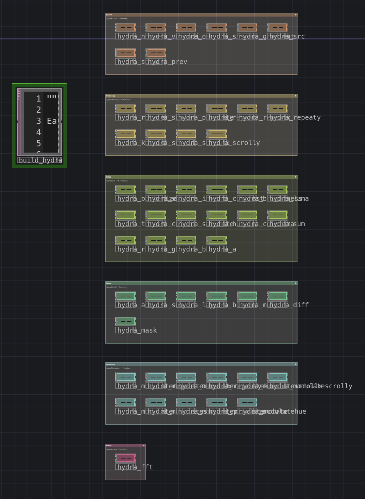

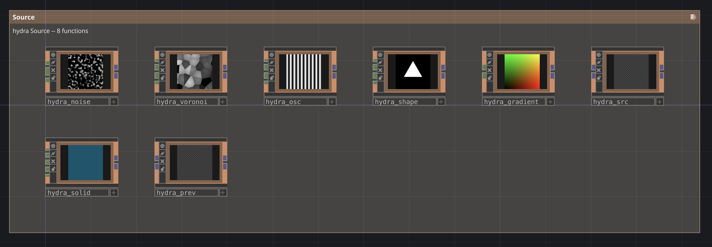

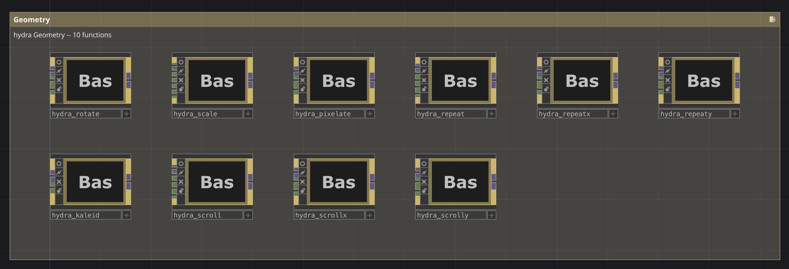

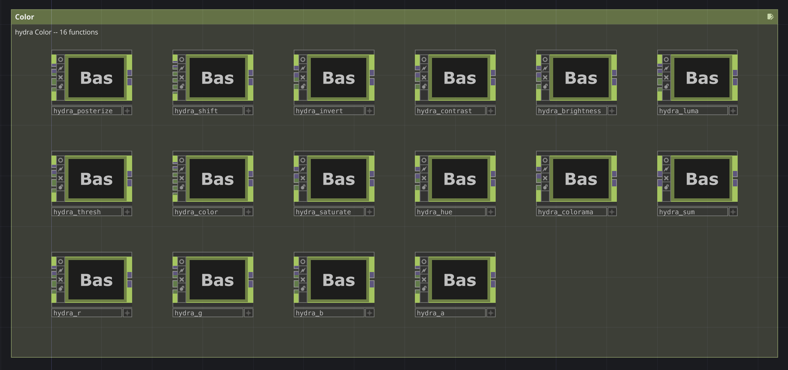

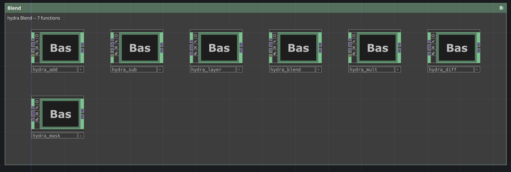

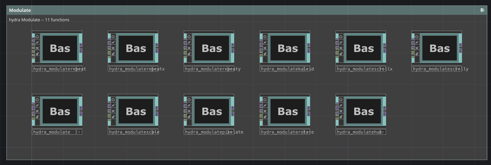

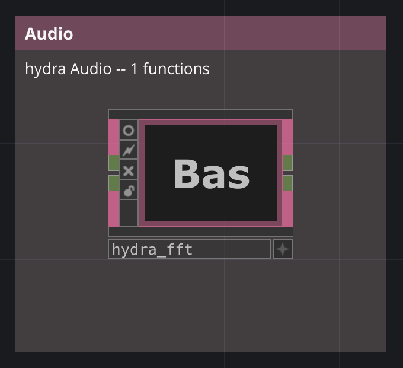

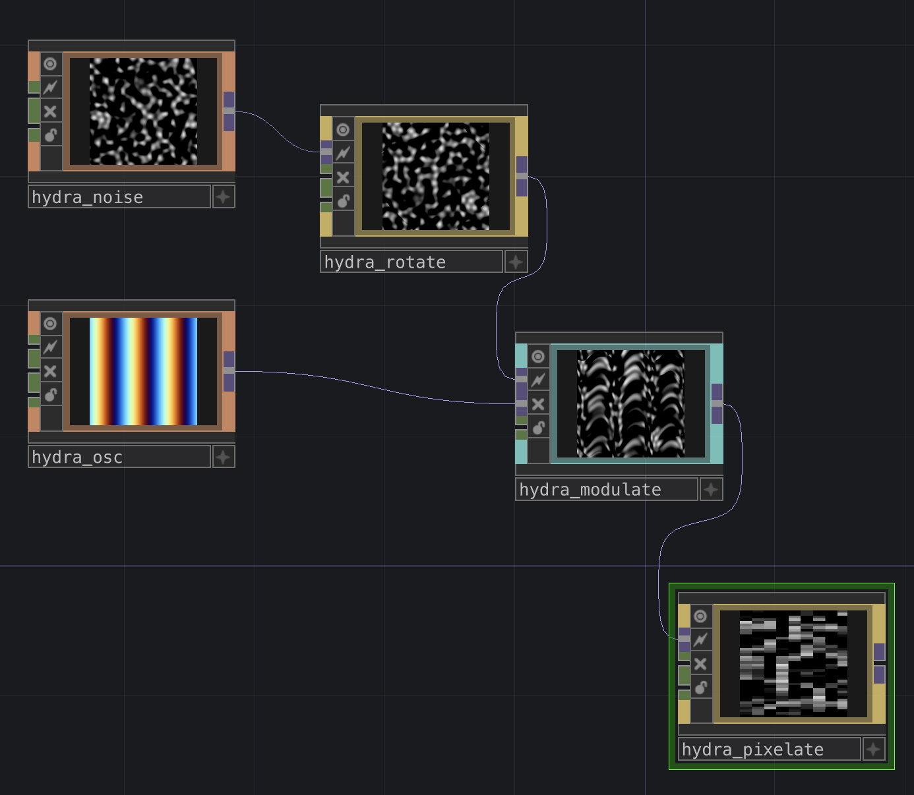

### Examples

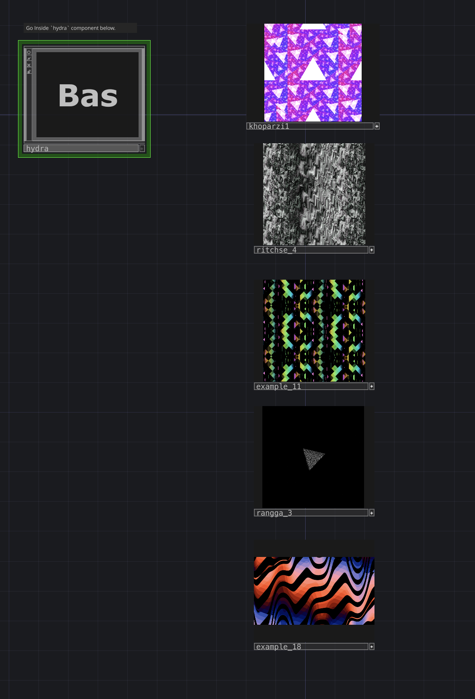

 [`khoparzi_1` at Hydra](https://hydra.ojack.xyz/?sketch_id=khoparzi_1)

 [`ritchse_4` at Hydra](https://hydra.ojack.xyz/?sketch_id=ritchse_4)

 [`rangga_3` at Hydra](https://hydra.ojack.xyz/?sketch_id=rangga_3)

 [`example_11` at Hydra](https://hydra.ojack.xyz/?sketch_id=example_11)

 [`example_18` at Hydra](https://hydra.ojack.xyz/?sketch_id=example_18)

 [`flor_2` at Hydra](https://hydra.ojack.xyz/?sketch_id=flor_2)

 [`example_10` at Hydra](https://hydra.ojack.xyz/?sketch_id=example_10)

## Function-to-Component Logic

Each Hydra function is converted to a corresponding TD Component holding its shader source inside, together with wiring of parameters to shader inputs. Output is mapped to be the output of the component (TOP).

For every numeric argument, both CHOP-based input and parameter key/value pair are created (on `Hydra` tab). If there is no input for this argument connected, then the parameter value/expession is used. So you can either put values or expressions on the parameters tabs or connect CHOPs instead, both ways are supported.

For source arguments any TOP component may be passed in the input.

Also includes `hydra_fft` CHOP which replicates `a.fft[n]` functionality of Hydra, but creates a channel output for every bin.

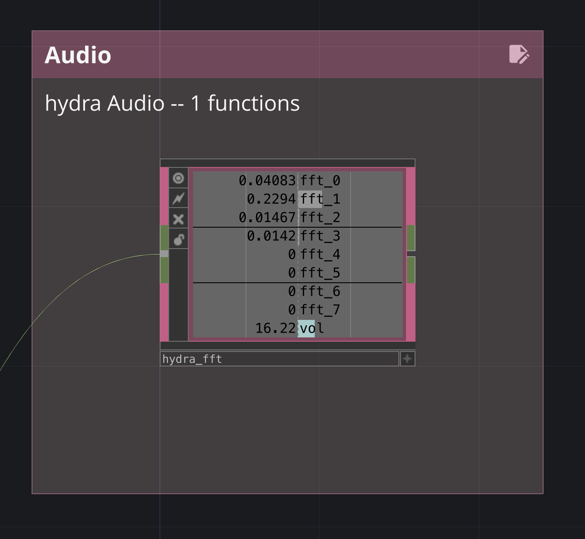

## What You Get

The main thing this project provides is **the `hydra` component** — `components/hydra/hydra.tox` (also set up inside `Hydra.toe`). It is a Base COMP holding all the [Hydra functions as components](#components), plus the generator `build_hydra`.

**Having it in your project is enough to create things with Hydra.** Drop `hydra.tox` into your project (say, at `/project1/hydra`) and treat it as a library. A build with `tox=True` writes it anew, so it matches the components next to it:

* **take copies by hand** — copy any `hydra_<fn>` component from inside it and paste it into your network. Every component is self-contained (its function, shader compiler and callbacks live inside it), nothing else is needed;
* **or, easier, spawn them from the Textport**:

  ```python
  b = mod('/project1/hydra/build_hydra')
  b.spawn('osc noise*2 rotate modulate')        # copies land next to the library, in /project1
  b.spawn(['osc'], dest=op('/project1/sketch')) # or anywhere else
  ```

  `build_hydra` reads its sibling files (`hydra_compile.py`, `hydra-functions.json`, ...) when imported, so for the Textport way keep the `assets/scripts/hydra` folder next to your `.toe`, at the same relative path.

Then wire them the way you chain functions in Hydra: `osc → rotate → modulate` is `osc().rotate().modulate(...)`. Every argument is both a parameter on the component's `Hydra` page and a CHOP input you can connect anything to.

**Versions.** Turn on the Viewer flag of the `hydra` component and it shows its title and the version it was built from. The `hydra` component and every function inside it carry a read-only **Version** page: the builder's version (currently `0.4.1`), the hash of the embedded compiler, and the build time. All the components inside one `hydra` are built together, so they share the version shown on the `hydra` component itself. Copies you placed keep the version they were made with; `b.version_report(op('/project1'))` lists the outdated ones and `b.upgrade(op('/project1'))` brings them up to date (see [Upgrading](#upgrading-placed-copies-and-versions)).

## Components

Grouped as inside the `hydra` component. Arguments are given with their defaults; every numeric one is both a parameter and a CHOP input. Image inputs (TOPs) are listed separately.

### Source

Generators: no image input (except `src` and `prev`, which read theirs on `source`), each has its own **Resolution** on the `Output` page.

* `hydra_osc` — `osc(frequency=60, sync=0.1, offset=0)` — sine-wave stripes, `offset` shifts the colour channels apart;
* `hydra_noise` — `noise(scale=10, offset=0.1)` — animated Perlin-like noise;
* `hydra_voronoi` — `voronoi(scale=5, speed=0.3, blending=0.3)` — animated Voronoi cells;
* `hydra_shape` — `shape(sides=3, radius=0.3, smoothing=0.01)` — regular polygon, many `sides` give a circle;
* `hydra_gradient` — `gradient(speed=0)` — XY colour gradient, rotating hue with `speed`;
* `hydra_solid` — `solid(r=0, g=0, b=0, a=1)` — a single colour;
* `hydra_src` — `src(tex)` — any TOP as a source (camera, movie, another chain, Feedback TOP...);
* `hydra_prev` — `prev()` — Hydra's previous-frame buffer; here it reads whatever you wire into it, e.g. a Feedback TOP.

### Geometry

Transform the coordinates of everything upstream. One image input: `source`.

* `hydra_rotate` — `rotate(angle=10, speed=0)` — rotate by `angle` (degrees), continuously with `speed`;
* `hydra_scale` — `scale(amount=1.5, xMult=1, yMult=1, offsetX=0.5, offsetY=0.5)` — zoom, per axis, around the offset point;
* `hydra_pixelate` — `pixelate(pixelX=20, pixelY=20)` — blocky pixels, count per axis;
* `hydra_repeat` — `repeat(repeatX=3, repeatY=3, offsetX=0, offsetY=0)` — tile in both axes, shifting every other row/column;
* `hydra_repeatx` — `repeatX(reps=3, offset=0)` — tile horizontally;
* `hydra_repeaty` — `repeatY(reps=3, offset=0)` — tile vertically;
* `hydra_kaleid` — `kaleid(nSides=4)` — kaleidoscope with `nSides` mirrors;
* `hydra_scroll` — `scroll(scrollX=0.5, scrollY=0.5, speedX=0, speedY=0)` — shift in both axes, continuously with speed;
* `hydra_scrollx` — `scrollX(scrollX=0.5, speed=0)` — shift horizontally;
* `hydra_scrolly` — `scrollY(scrollY=0.5, speed=0)` — shift vertically.

### Color

Change the colour of the input. One image input: `source`.

* `hydra_posterize` — `posterize(bins=3, gamma=0.6)` — reduce to `bins` levels per channel;
* `hydra_shift` — `shift(r=0.5, g=0, b=0, a=0)` — shift each channel, wrapping around;
* `hydra_invert` — `invert(amount=1)` — invert colours;
* `hydra_contrast` — `contrast(amount=1.6)` — contrast around mid-grey;
* `hydra_brightness` — `brightness(amount=0.4)` — add brightness;
* `hydra_luma` — `luma(threshold=0.5, tolerance=0.1)` — keep only what is brighter than `threshold` (luma key);
* `hydra_thresh` — `thresh(threshold=0.5, tolerance=0.04)` — black and white by brightness threshold;
* `hydra_color` — `color(r=1, g=1, b=1, a=1)` — multiply channels by a colour;
* `hydra_saturate` — `saturate(amount=2)` — saturation, 0 is greyscale;
* `hydra_hue` — `hue(hue=0.4)` — rotate hue;
* `hydra_colorama` — `colorama(amount=0.005)` — shift hue, saturation and value at once, psychedelic;
* `hydra_sum` — `sum(scale=[1, 1, 1, 1])` — weighted sum of the channels (a `vec4` parameter, no CHOP input);
* `hydra_r` — `r(scale=1, offset=0)` — red channel only, as greyscale;
* `hydra_g` — `g(scale=1, offset=0)` — green channel only;
* `hydra_b` — `b(scale=1, offset=0)` — blue channel only;
* `hydra_a` — `a(scale=1, offset=0)` — alpha channel only.

### Blend

Combine two images. Image inputs: `source` and `with` (the `texture` argument).

* `hydra_add` — `add(texture, amount=1)` — add colours;
* `hydra_sub` — `sub(texture, amount=1)` — subtract colours;
* `hydra_mult` — `mult(texture, amount=1)` — multiply colours;
* `hydra_blend` — `blend(texture, amount=0.5)` — crossfade between the two;
* `hydra_diff` — `diff(texture, amount=1)` — absolute difference;
* `hydra_layer` — `layer(texture, amount=1)` — put the texture on top, by its alpha;
* `hydra_mask` — `mask(texture, amount=1)` — use the texture's brightness as alpha.

`amount` on `diff`, `layer` and `mask` is our addition (Hydra has none there); at its default of 1 they behave exactly like Hydra.

### Modulate

Distort the coordinates of `source` using the colours of the second image, the `modulator`.

* `hydra_modulate` — `modulate(texture, amount=0.1)` — displace by the modulator's red/green;
* `hydra_modulatescale` — `modulateScale(texture, multiple=1, offset=1)` — zoom by the modulator;
* `hydra_modulaterotate` — `modulateRotate(texture, multiple=1, offset=0)` — rotate by the modulator;
* `hydra_modulatepixelate` — `modulatePixelate(texture, multiple=10, offset=3)` — pixelate by the modulator;
* `hydra_modulatehue` — `modulateHue(texture, amount=1)` — displace by the hue difference with the modulator;
* `hydra_modulatekaleid` — `modulateKaleid(texture, nSides=4)` — kaleidoscope driven by the modulator;
* `hydra_modulaterepeat` — `modulateRepeat(texture, repeatX=3, repeatY=3, offsetX=0.5, offsetY=0.5)` — tile, offsets driven by the modulator;
* `hydra_modulaterepeatx` — `modulateRepeatX(texture, reps=3, offset=0.5)` — tile horizontally, driven by the modulator;
* `hydra_modulaterepeaty` — `modulateRepeatY(texture, reps=3, offset=0.5)` — tile vertically, driven by the modulator;
* `hydra_modulatescrollx` — `modulateScrollX(texture, scrollX=0.5, speed=0)` — horizontal shift driven by the modulator;
* `hydra_modulatescrolly` — `modulateScrollY(texture, scrollY=0.5, speed=0)` — vertical shift driven by the modulator.

### Audio

* `hydra_fft` — `a.fft[n]` — audio CHOP in, `fft_0 … fft_<Bins-1>` and `vol` channels out; parameters `Bins=4`, `Cutoff=2`, `Scale=10`, `Smooth=0.4`. Wire any channel straight into any argument's CHOP input.

## Building

For details on building, see [`assets/scripts/hydra/BUILD.md`](assets/scripts/hydra/BUILD.md).

`Hydra.toe` project includes all the function-components and the generator component `build_hydra` inside the `hydra` Base Component. Which is itself stored in `components/hydra`.

`build_hydra` is a Text DAT synced to `assets/scripts/hydra/build_hydra.py`. It is *imported*, not run, so all the commands go to the Textport:

```python
b = mod('/project1/hydra/build_hydra')

b.build_all(op('/project1/hydra'))    # build everything (replaces same-named components)
b.build_all(op('/project1/hydra'), tox=True, palette=True)   # ... and write .tox files and the Palette
b.rebuild(op('/project1/hydra'))      # wipe all generated components, then build (same flags)
b.clear(op('/project1/hydra'))        # wipe only
b.build_audio(op('/project1/hydra'))  # just hydra_fft
b.build(spec, op('/project1/hydra'))  # a single component, from one spec dict (see b.load_specs())
```

`build_all` and `rebuild` take five stage flags:

* `layout=True` — arrange and annotate the groups;
* `audio=True` — build `hydra_fft`;
* `cover=True` — build the `hydra` component's viewer: the title and its current version (`b.build_cover(op('/project1/hydra'))` alone);
* `tox=False` — write `components/hydra/hydra.tox` and `components/hydra/<group>/hydra_<fn>.tox`;
* `palette=False` — write the same into your Palette, under `/My Components/Hydra` (the whole library as `hydra`, every function under its group).

The two that write files are off by default, so a build never overwrites files unless you ask for it: `b.rebuild(op('/project1/hydra'), tox=True, palette=True)`. BE AWARE: they overwrite whatever is there.

ALSO BE AWARE: `clear` and `rebuild` destroy **every** `hydra_*` component and **every** Annotate COMP directly in the target container, including annotations you added by hand. Keep the library container for generated content only, and patch with spawned copies elsewhere (see below).

### Exporting

```python
b.export_tox(op('/project1/hydra'))      # write components/hydra/hydra.tox and components/hydra/<group>/hydra_<fn>.tox
b.export_palette(op('/project1/hydra'))  # write the same into the TD user palette
b.export_palette(op('/project1/hydra'), root='/some/other/Palette')
b.layout_groups(op('/project1/hydra'), b.load_specs())   # only re-arrange and re-annotate the groups
```

Every `.tox` is self-contained: the function spec, the compiler and every callback live inside it, nothing is file-synced. Export only writes and never deletes, so a renamed function leaves its old `.tox` behind. Refresh the Palette pane after an export, it does not watch the folder.

### Upgrading placed copies and versions

A placed copy carries its own internals, so a change in the builder or the compiler does not reach it by itself. Every component has a read-only **Version** page: `version` (the builder's `VERSION`), `compiler` (hash of the embedded `hydra_compile.py`) and `built` (time of the build or last upgrade).

```python
b.upgrade(op('/project1'))          # bring every placed copy under it, recursively, up to the current code
b.version_report(op('/project1'))   # list components not built from the current code; empty = all current
```

`upgrade` keeps the wiring, parameter values and node positions, creates whatever the copy lacks and rewrites only what is generated (spec, compiler, callbacks, shader). It identifies components by the spec stored on them (or their `hydra:fn:` tag), never by name, so renamed copies are recognised too.

After a `hydra` update upstream: run `./assets/scripts/hydra/generate-hydra-functions.sh` to refresh the JSON, then `b.rebuild(...)` and `b.upgrade(...)` in TD.

When reporting a problem, the version and compiler hash of the component involved say exactly which code it runs.

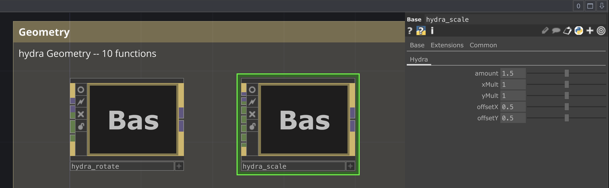

## Structure

* `Hydra.toe` — the project containing `hydra` base component (`hydra.tox`) already set up to make cloning them or building new versions easier;
* `components/hydra/hydra.tox` — the `hydra` base component containing all the functions-components as well as the generator (`build_hydra`);
* `components/hydra/<group>/hydra_<fn>.tox` — the components files themselves.
* `assets/scripts/hydra/*` — the code for generating components, the main script is `build_hydra.py`;
* `assets/scripts/hydra-functions.json` — the source of `hydra` functions and their arguments used when building; Converted from `hydra` sources and can easily be updated;
* `assets/scripts/hydra/shader/<fn>.frag` — fragment shader source for every `hydra` function, used inside the components;
* `assets/scripts/hydra/hydra_seq.py` — a helper to work with `hydra`-like sequences in TD: e.g. `[1, 2, 3, 4].fast()`. But since all of them can easily be recreated using basic TD functionality, it is left for academic purposes mostly;

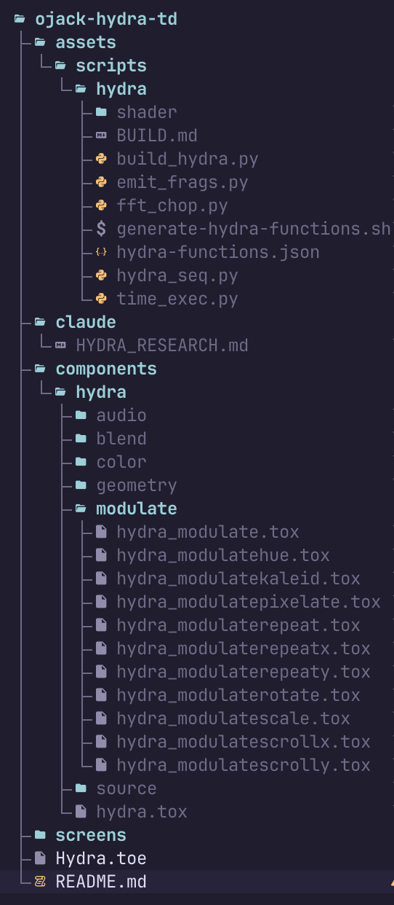

## Features

`build_hydra` script has many helpers. All the ones taking a container search it recursively, nested containers included.

### Spawning

The generated components are a library — patch with copies of them, not with the originals:

* `b.spawn(['osc', 'osc', 'rotate', 'scale'])` would spawn copies of those components from the library into the library's parent (your project root, by default);
  * `b.spawn(['osc*3', 'rotate'])` or `b.spawn('osc*3 rotate scale')` — counts and a single string work too;
  * pass `, dest=op('/project1/sketch')` to spawn them to some other destination;
  * pass `, postfix='_a'` to spawn them with postfix after the name (`hydra_osc_a`); repeats get a numeric suffix (`hydra_osc`, `hydra_osc1`);
  * pass `, lib=op('/some/other/hydra')` to spawn from a different library;
* `spawn` returns the created components, so you can wire them right away:

```python
a, n, m = b.spawn(['osc', 'noise', 'modulate'])
m.inputConnectors[0].connect(a)   # source
m.inputConnectors[1].connect(n)   # modulator
```

Copies land outside the library on purpose: they inherit the `hydra` tag, so `clear()` / `rebuild()` of the library would destroy them too.

### Modes: Compiled and Image

Every component has a **Mode** on its **Pipeline** page:

* **Compiled** (default) — hydra's own model: the component walks the wiring upstream and fuses every Compiled hydra component into one shader, the way hydra does, so `osc → rotate → scale` evaluates `osc(rotate(scale(st)))` in a single pass: nothing is resampled, nothing seams;
* **Image** — renders this component on its own and makes it a texture for everything downstream. Use it for a slow source shared by several branches or one that doesn't change over time; keep it out of the way of `rotate` / `scale` / `kaleid`, since downstream of it they sample a finite texture again.

```python
b.set_mode(op('/project1/sketch'), 'image')     # or 'compiled', on every component under it
```

A chain recompiles by itself on rewiring, renaming, Viewer flag or Mode change; the **Compile** pulse forces it. Parameter and CHOP changes need no recompile. Compiled components that nothing looks at (no Viewer, no output) are not compiled at all.

### Time

The functions that use `time` (`osc`, `noise`, `voronoi`, `gradient`, `rotate`, `scroll*`, `modulateScroll*`) have a **Time Sync** page with a **Time** parameter holding `absTime.seconds`. Replace it with any expression (Timer CHOP, a slowed clock, ...) and pulse **Propagate Time Expr** to copy it to every hydra component downstream.

### Resolution and Output

* `b.set_resolution(op('/project1/hydra'), 1280, 1280)` sets given resolution to all Hydra source components at given path (source components such as `osc` or `shape`, all have `Output` tab individually to allow setting it on your own). Everything else follows the resolution of its chain's source. Default is 1280×720; a non-commercial licence caps output at 1280×1280, and `set_resolution` warns when you ask for more;
* `b.set_output(op('/project1/hydra'), smoothness='nearest')` / `b.set_output(op('/project1/hydra'), pixel_format='8-bit')` — set input smoothness and pixel format on every component (matched by substring against TD's menu). `nearest` + 8-bit is what hydra itself uses and keeps feedback loops crisp; 16-bit float keeps negative values when `noise()` feeds `modulate()`.

### Debugging

* `b.version_report(op('/project1'))` — components not built from the current code;
* `b.cook_report(op('/project1/sketch'))` — last-frame GPU and CPU cook time per component;
* `b.dump_shaders(op('/project1'))` — write every generated shader to `build/hydra-shaders/<path>.frag` (git-ignored, export only), pass `root='/some/folder'` to change the place.

### Tags

Every generated component is tagged `hydra`, `hydra:fn:<func>` and `hydra:class:<class>`, so you can find them yourself:

```python
op('/project1/hydra').findChildren(tags=['hydra:class:coord'])
```

`hydra_seq` script can be used to emulate Hydra array arguments which allow to step over a set of values with constant speed or with easing. Same and even much more powerful can be achieved using CHOPs of course, so you have a freedom to choose any way you prefer.

Associate Text DAT with `hydra_seq.py` and then put in any expression:

* `mod('/project1/hydra/hydra_seq').val([0.1, -0.0625, 0.005, 0.00001])` — same as `[0.1, -0.0625, 0.005, 0.00001]` argument in hydra;
* `mod('/project1/hydra/hydra_seq').val([0.1, -0.0625, 0.005, 0.00001], speed=2)` — same as `[0.1, -0.0625, 0.005, 0.00001].fast(2)` argument in hydra;
* `mod('/project1/hydra/hydra_seq').val([0.1, -0.0625, 0.005, 0.00001], smooth=1)` — same as `[0.1, -0.0625, 0.005, 0.00001].smooth()` argument in hydra;
* `mod('/project1/hydra/hydra_seq').val([0.1, -0.0625, 0.005, 0.00001], ease='easeInOutCubic')` — same as `[0.1, -0.0625, 0.005, 0.00001].ease('easeInOutCubic')` argument in hydra;
